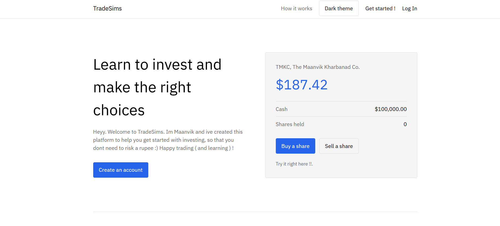
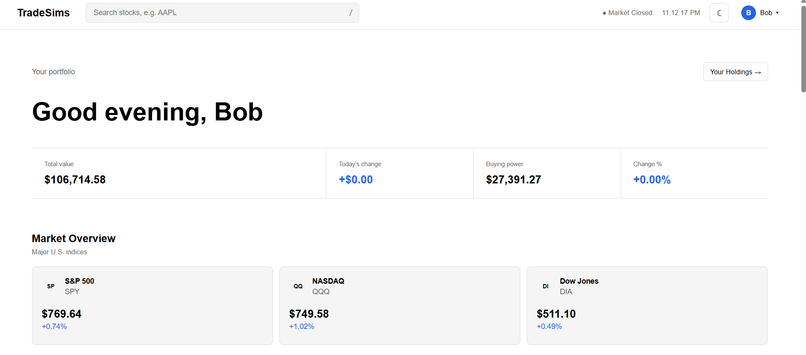
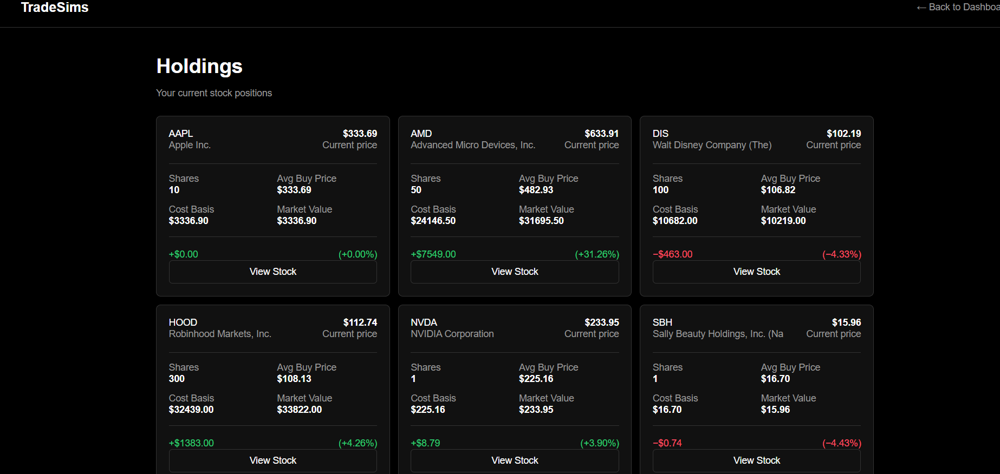
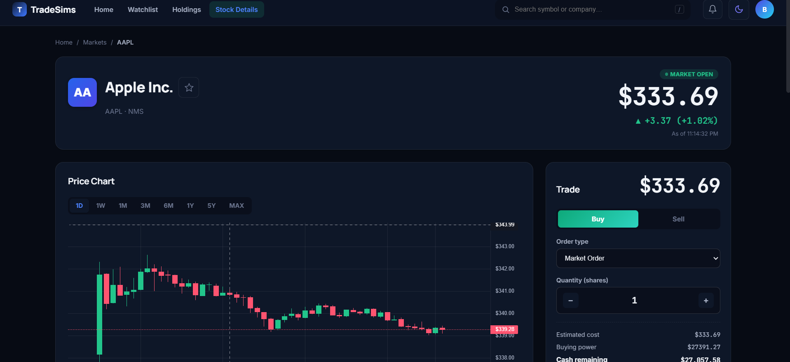

# TRADESIMS 

Tradesims is a web based trading simulator built using:
- Python's Django as the main framework
- Vanilla CSS and JS
- Supabase For Hosting database
- Redis for caching
- Nest container to host
- Me for the frustration :(

## Tradesims offers
- Real time data
- Multiple statistics
- A very good UI (According to me)
- Both mobile and Laptop support

## Some things that are not offered

- OAuth support
- Password reset (I forgot 😭😭)
- 100% uptime :(
  - The app is mostly functional, but sometimes it tends to crash, and takes a while to fix

## Installation

Heres a quick overview of how to install:

- CLone the repo with ```git clone https://github.com/mk150710/trading_sim.git```
- Create a venv names `Proj_env` with `python -m venv Proj_env` 
- Activate using `Proj_env\Scripts\activate`
- Copy example env `cp example.env .env`
- Configure redis and postgress in their respective env placeholders. You can get personal access links from their respective websites
- Install dependencies with `pip install -r requirements.txt`
- Run :
  ```
  python manage.py makemigrations
  python manage.py migrate
  ```
To migrate database
- Start the website with `python manage.py runserver`
Check it out at `http://127.0.0.1:8000/`

For the full setup instructions, see the [Install Guide](Install.md).

## For hackclub Judges ( Or anyone interested )

Check out the website:
<br> [Video demo](https://youtu.be/TZq8kFMua1I)<br><br>
Install on your own system:<br>
 [Install Guide](Install.md)<br><br>
For any complaints or suggestions feel free to reach out on:<br> [Instagram](https://www.instagram.com/maanvik_157/)

# My project in working

- ## The Landing Page

- ## The Dashboard

- ## User Holdings

- ## Stock Page
